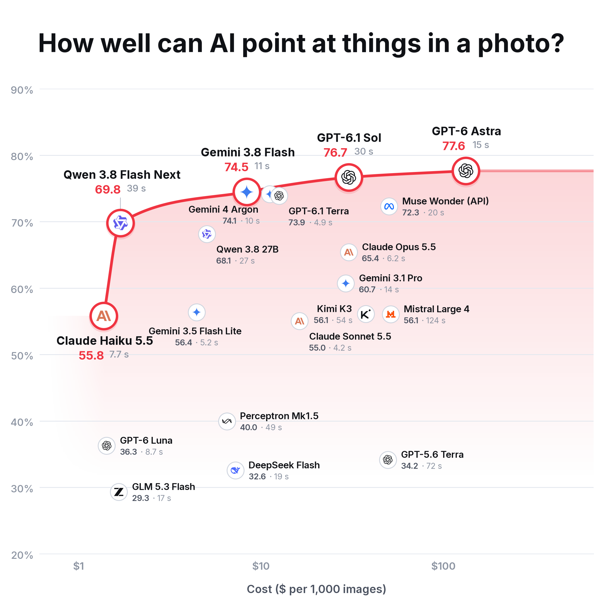
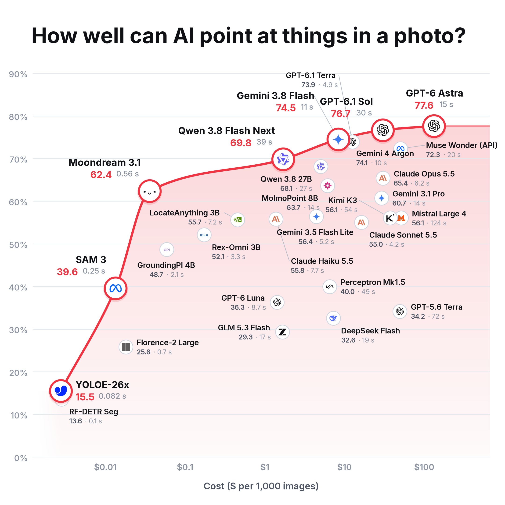
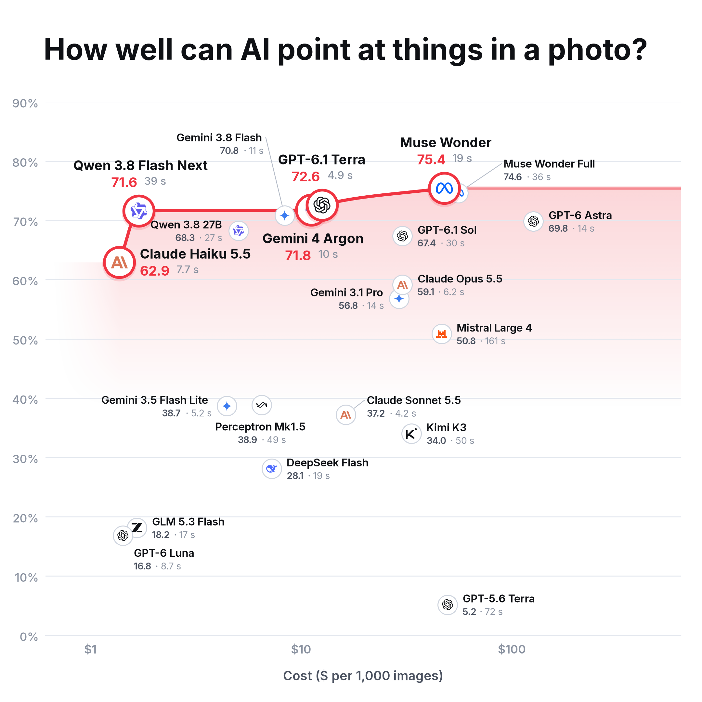
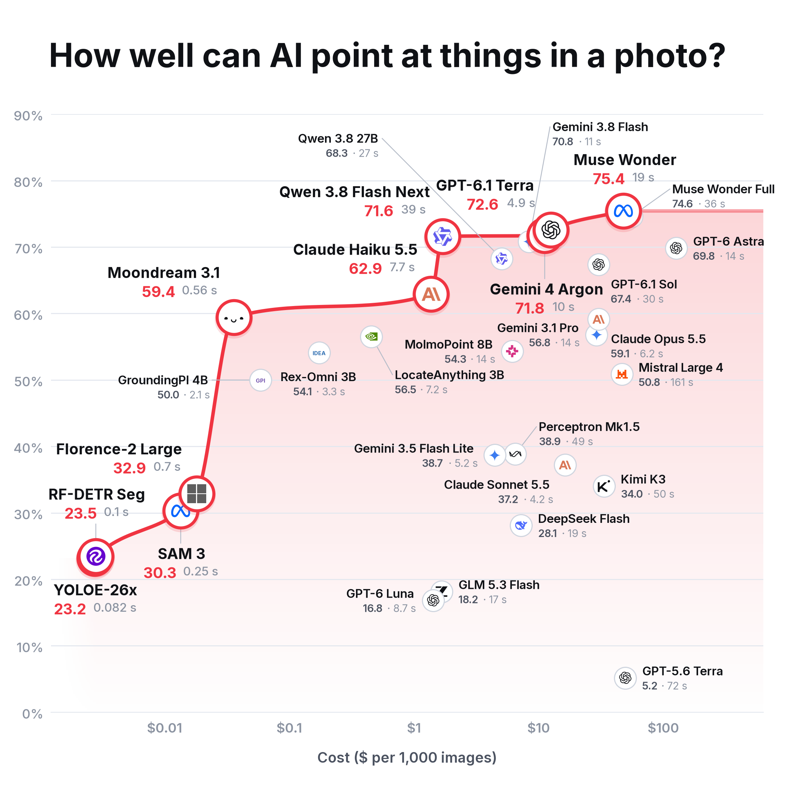
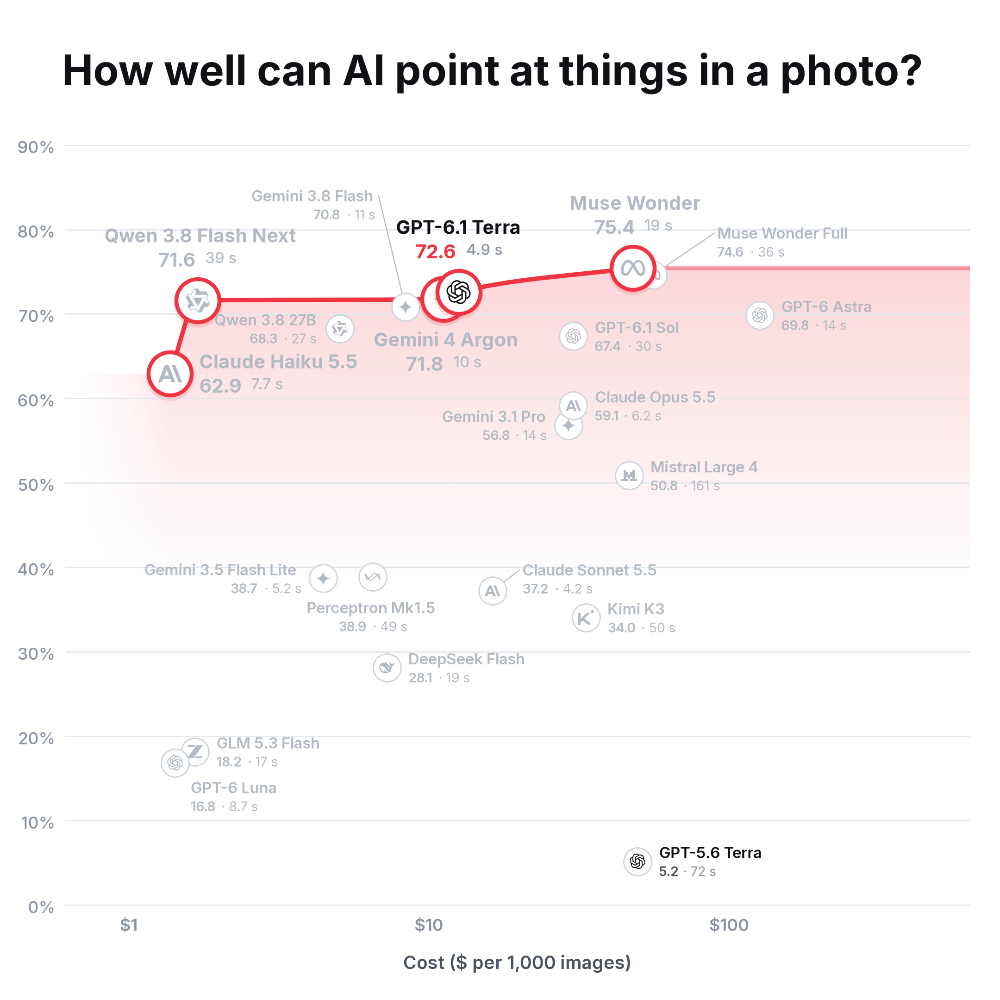
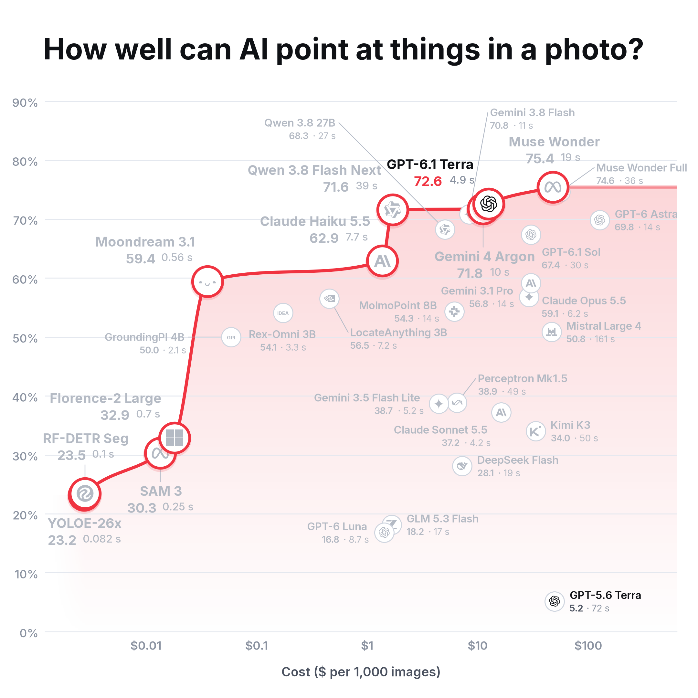
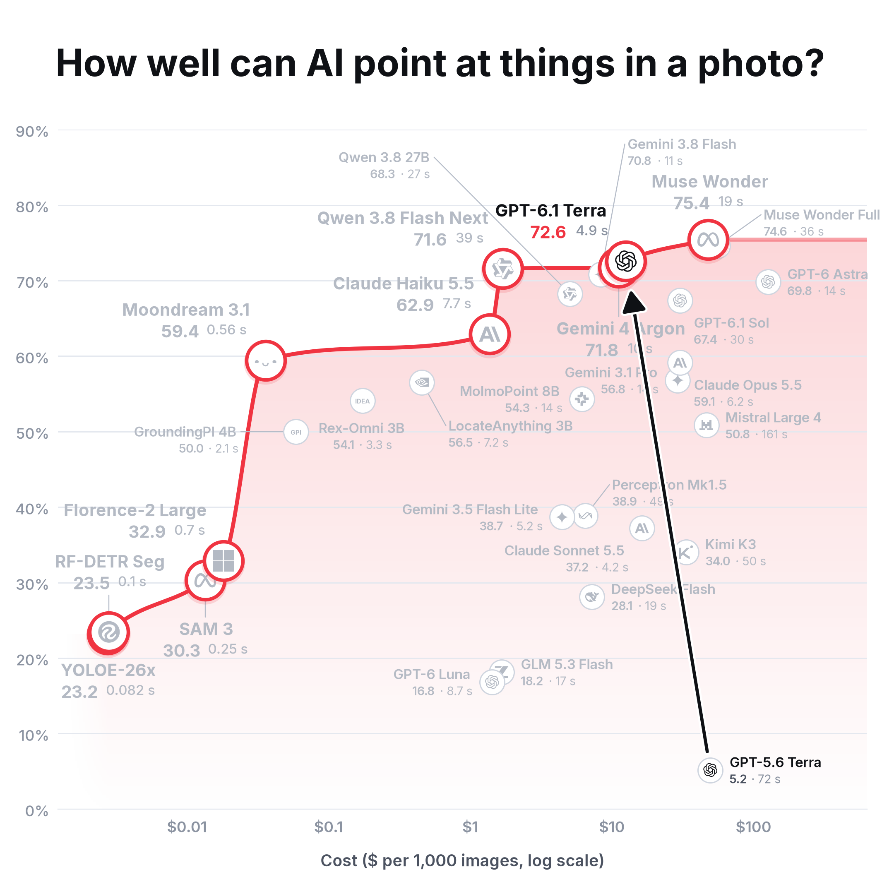
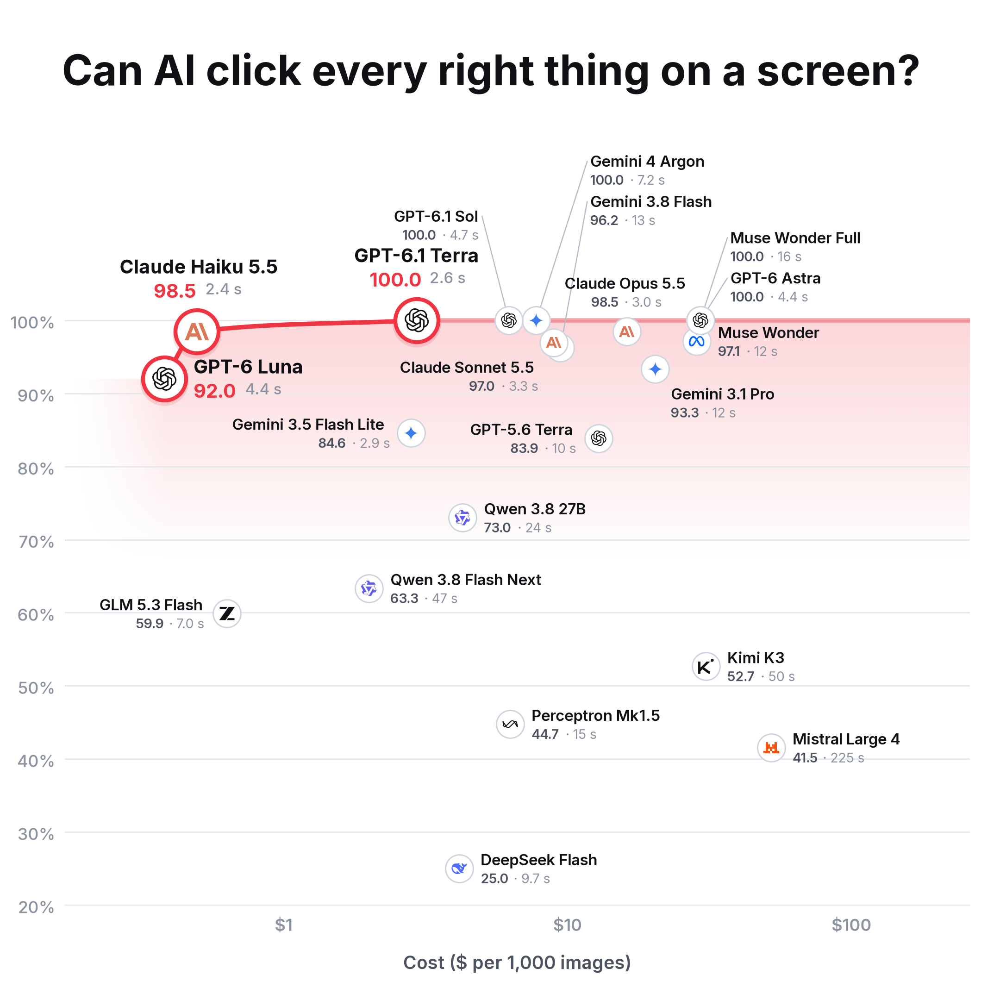
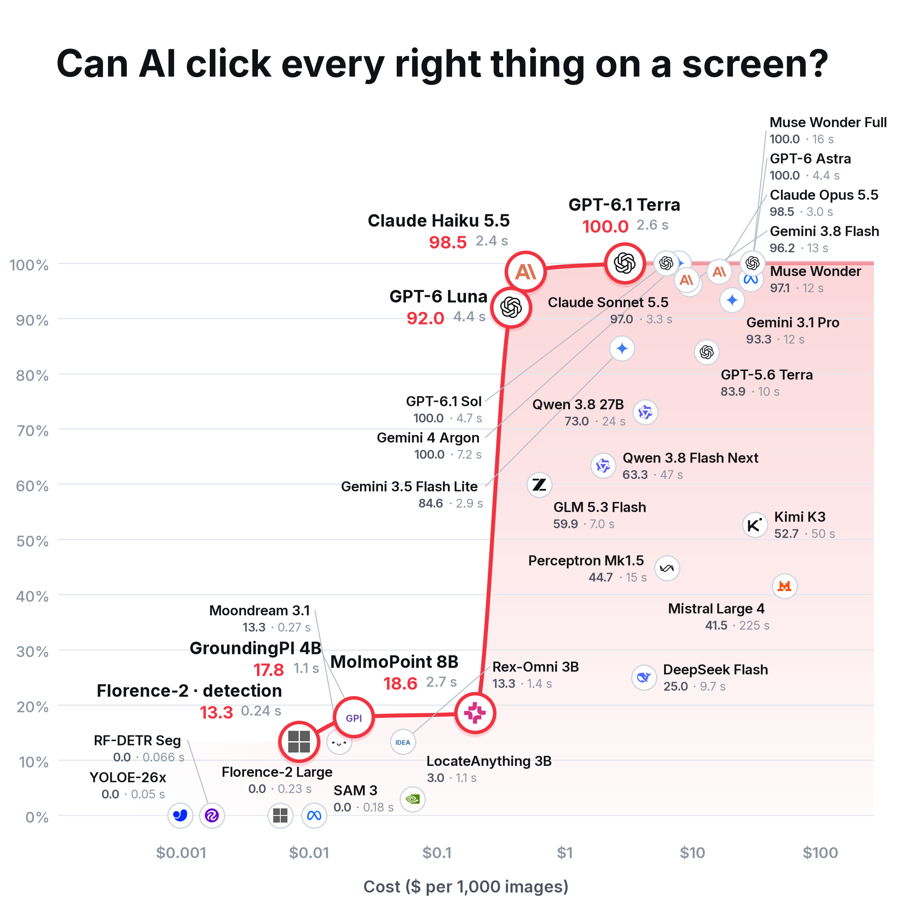

# Preview: GPT-6.1 Terra added to the usual charts (2026-10-26, not published)

GPT-6.1 Terra (`terra-6.1`, our ChatGPT plan, medium thinking, 3 tries of
each question) added to the existing results. GPT-5.6 Terra stays on every
chart. When made, nothing published was changed (the site read
`charts/point-benchmark-v2.7` and `charts/screens-2`). Published on
2026-10-29 as point benchmark v2.8 and in `charts/screens-2`
(docs/point-benchmark-v2.md, "v2.8").

## Photos, all 11 photos (point benchmark v3)

GPT-6.1 Terra: **73.9**, 5th of 29 (GPT-5.6 Terra: 34.2).

## Photos, the 4 photos on the public site (point benchmark v2.7)

GPT-6.1 Terra: **72.6**, 3rd of 30 (GPT-5.6 Terra: 5.2).

## The 4 photos, only the two Terras in colour

Same chart and numbers as above; every other model greyed out
(`scripts/draw_charts.py --highlight terra@medium --highlight terra-6.1@medium`).

## The 4 photos with local models, Terras highlighted, with an arrow

The chart above (with local models) plus an arrow from GPT-5.6 Terra to
GPT-6.1 Terra. Made by `point-benchmark-v2.7-terra-arrow/draw_arrow.py`, which
runs the usual chart script unchanged and adds the arrow and "log scale" on the cost axis just before saving
(straight; a bent arrow crossed more labels).

## Screenshots (round 2)

GPT-6.1 Terra: **100**, tied with GPT-6 Astra, GPT-6.1 Sol, Gemini 4 Argon and
Muse Wonder Full (GPT-5.6 Terra: 83.9).

## How these were made

- Photos: the published scored results (`results/point-benchmark-v2.7`,
  `results/point-benchmark-v3`) copied unchanged, plus GPT-6.1 Terra's answers
  scored the same way (same reference points, lenient reading, its better
  prompt, v2 on both). Each model's score depends only on its own answers, so
  no other model's number moves. Merged results:
  `results/preview/terra-6.1/point-benchmark-{v2.7,v3}/`; drawn with
  `scripts/plot_point_pilot.py`, which checks every dot against the scores.
- Screenshots: `scripts/plot_screens.py` on exactly the answer files of the
  published `charts/screens-2` (same checksums) plus GPT-6.1 Terra's lines.
- Label pins: the published charts' pins, plus, on the 11-photo
  language-model chart only, GPT-6.1 Terra's label lower right (`lr`) and
  Gemini 4 Argon's lower left (`ll`): their discs nearly coincide (73.9 vs
  74.1, about $12 per 1,000 photos each).
