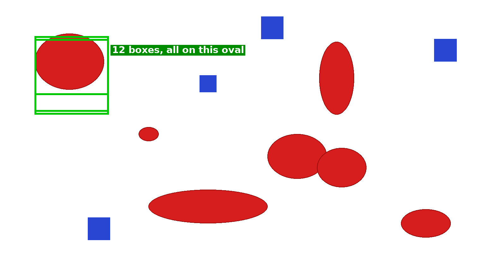
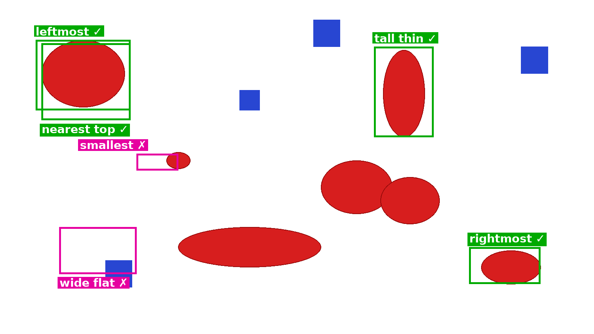
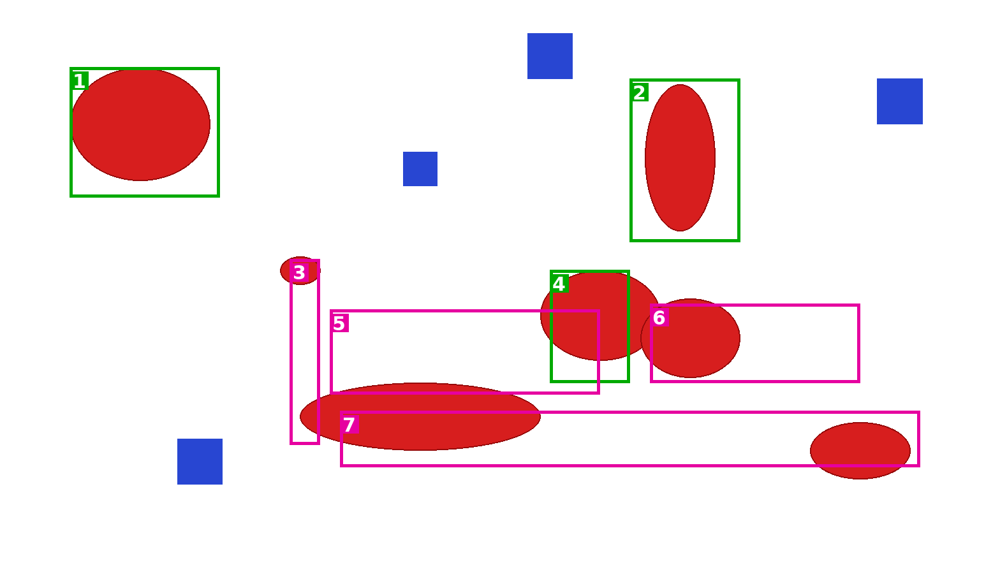
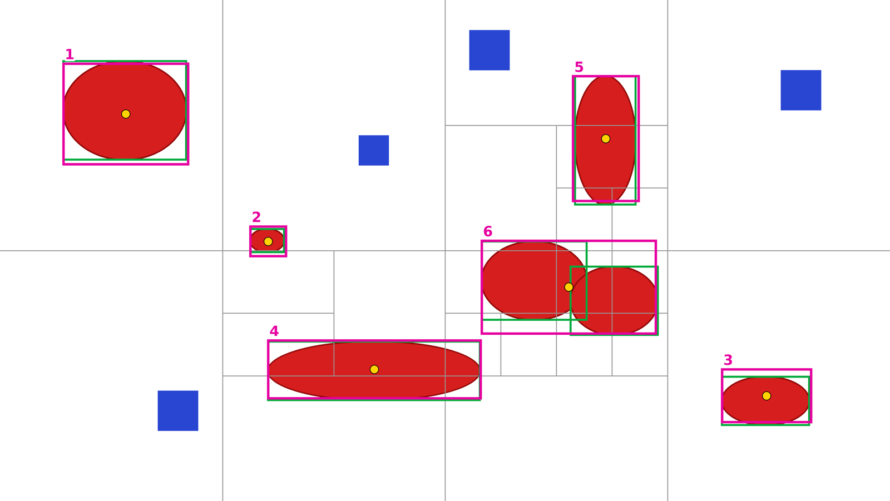
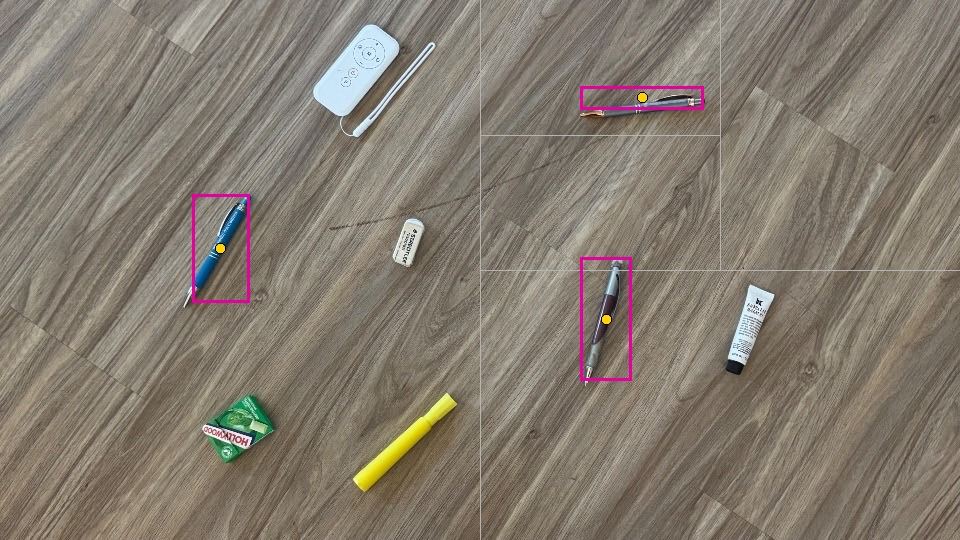
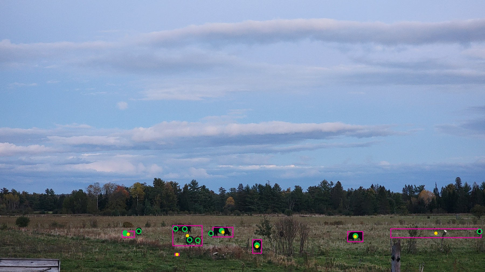
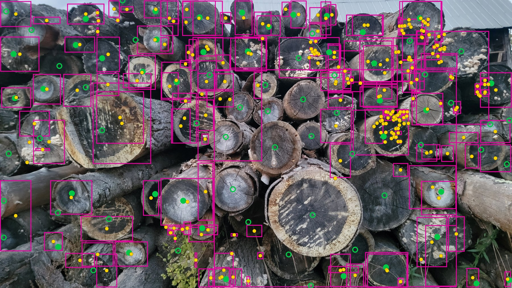
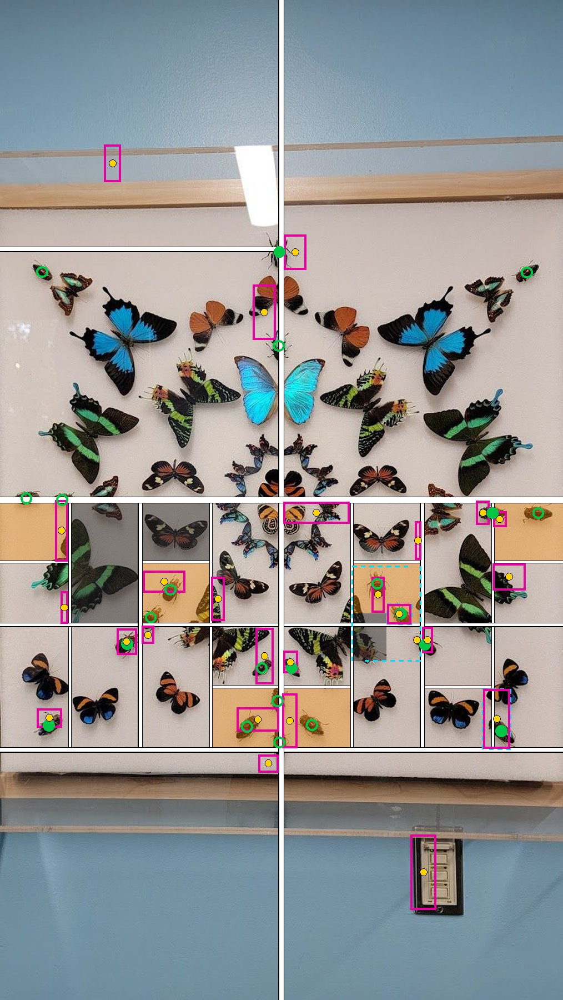
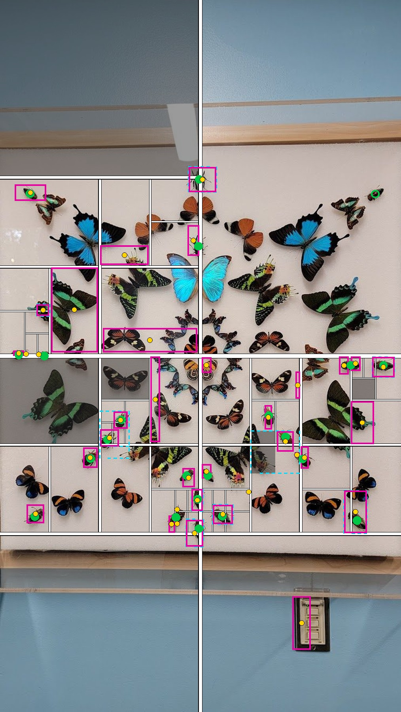
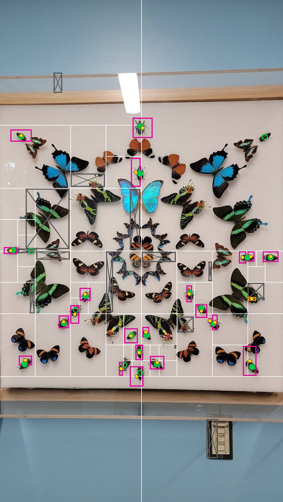

# Jev 1.14, first tests (2026-10-15), drawn from the saved answers

Fake picture: 7 red ovals, 4 blue squares, 1568x883. One run each; no new requests were made to draw these.
Data: `results/probe-jev-round2-20261015-162038.json` (1) and `results/probe-jev-20261015-161946.json` (2, 3).

## 1. Keep the boxes on the picture, ask for one without a frame

Each round: "a red oval that has no green frame drawn around it", then a green frame is drawn on the box Jev gave.
Jev boxed **the same top-left oval all 12 times** (stopped at the round limit). It also said every time,
at 0.98-0.99, that an unframed oval was still there. Found: 1 of 7.

## 2. Ask by position or shape (6 boxes in one request, 0.16 s)

Green = the box is on the right oval; pink = wrong. **4 of 6.**
"smallest" landed just left of the small oval; "wide flat" landed on empty space by a blue square.

## 3. Erase what was found, ask again

Each box was painted white, then Jev was asked again. Numbers are the order. Green = on one oval (overlap 50%+).
Found 3 of 7. Once ovals were half erased, the boxes spread across leftovers of several ovals; at round 8 Jev said
no oval was left (0.24). The boxes are drawn here on the original picture, not on the erased one Jev saw.

## 4. Halving (same 7 ovals, run 2026-10-15 21:02)

Ask "none / one / several" about a piece. "Several" means cut it in half and ask about each half; "one" means take the box.
Afterwards, parts of one oval split by a cut line are joined back together.
Pink = Jev's final box, green = the oval's true box, yellow dot = middle of Jev's box, grey lines = the cuts.
Data: `results/probe-jev-split-20261015-210225.json`; all four sizes: `results/probe-jev-split-view/index.html`.

| picture | boxes | ovals found (box middle on an oval) | tight boxes (overlap 75%+) | requests | time | cost |
|---|---|---|---|---|---|---|
| wide 4000x2252 (same layout as above) | 6 | **6 of 7** | 4 | 85 | 1.9 s | $0.005 |
| tall 2252x4000 | 7 | **7 of 7** | 7 | 81 | 1.7 s | $0.005 |
| square 1015x1015 | 7 | **7 of 7** | 6 | 84 | 1.2 s | $0.003 |
| small 743x1319 | 8 | **7 of 7** (1 extra box) | 4 | 59 | 1.2 s | $0.002 |

Wide: the two touching ovals got one shared box (6). Every other oval got its own tight box.

Tall: the touching pair came out as two boxes (6 and 7), so all seven were found.

## 5. Halving on real photos

### Your pens photo (2026-10-16, "each pen", 3 tries)

All three pens boxed tightly, nothing else boxed (not the highlighter, remote, eraser, gum or tube),
**the same in all three tries**. 10 requests, about 1 s, $0.0004 per try. The purple pen's tip crossed a
cut line; the joining step put the two parts back together. Video of the process: `results/probe-jev-pens/jev-halving-pens.mp4`.

### The 11 benchmark photos (run `jev-halving-1`, 3 tries each)

Overall **23.4%**, 27th of 29 entrants; $0.018 and 3.9 s per photo.
Pink = Jev's box, yellow = its middle (the point scored), filled green = answer-key point matched, green ring = missed.
All 11 pictures: `results/point-benchmark-v3-jev-halving-view/index.html`.

| photo | objects | Jev's boxes (3 tries) | score |
|---|---|---|---|
| cows | 11 | 7, 7, 9 | 40.2 |
| ants | 13 | 17, 16, 12 | 36.5 |
| fig | 33 | 53, 44, 47 | 33.6 |
| beetles | 22 | 26, 24, 23 | 33.6 |
| mushrooms | 14 | 34, 40, 29 | 23.7 |
| logs | 83 | 256, 215, 227 | 22.7 |
| pinkleaves | 37 | 15, 16, 16 | 21.5 |
| birds | 16 | 31, 26, 22 | 16.7 |
| jars | 6 | 8, 6, 6 | 16.1 |
| dishes | 26 | 31, 30, 30 | 12.6 |
| whitecow | 1 | 1, 1, 1 | 0.0 |

Cows (best photo): cows standing alone get good boxes; a group of four gets one box; one long box covers a fence post.

Logs (crowded): almost every small piece still holds part of some log, so Jev keeps answering "several"
down to the smallest pieces, which are then boxed anyway: clusters of tiny boxes on fungus and bark.

### Butterflies and beetles, with every cut (first try)

Task: "each beetle (not the butterflies)". 22 beetles; Jev gave 26 boxes, 8 matched; score 31.9%; 67 requests, 1.6 s.
Drawn by `scripts/view_jev_halving_cuts.py beetles 0` from `results/run-jev-halving-1.trees.jsonl`.

- White lines: the cuts (thicker = earlier cut).
- Grey pieces: Jev said "none". Orange pieces: still "several" at the deepest cut (7 halvings), boxed anyway.
  Untinted pieces ended on "one".
- Dashed cyan: a joined box asked again; it said "several" and was halved once more.
- Pink: final boxes; yellow: their middles; green: the beetles (filled = found).

What it shows:
- **The top half stopped too early.** The whole top-right quarter answered "one" (69%) though it holds
  several beetles: one box, on the beetle at the centre line. The beetles in the top corners were never looked for.
- **"One" pieces with no beetle get a box anyway.** Top-left corner: a box on the frame. Bottom half: a box
  on the shelf edge and one on the light switch.
- **Dense rows go to the bottom.** Among the butterflies the pieces were cut down to the smallest size.
  6 orange pieces still held 2-3 beetles each and got a single box.
- The grey "none" pieces were right: only butterflies there.

### Same photo, up to 15 halvings instead of 7 (3 new tries)

Score **56.7** (tries 61, 55, 54) against 33.6 with 7. Beetles found: 21, 19, 18 of 22 (was 8-9).
The deepest cut used was 10-12, so 15 was never reached; no piece was boxed by force.
Twice the requests (115-126), 3-5 s, $0.004 per try. Details: `docs/jev.md`.

### Same photo, 15 halvings + checking each box (3 new tries)

Each final box is shown to Jev again (the box plus a margin): "Is there a beetle in the middle?" Yes -> keep.
No -> grey it out, ask its piece again, check the new box once; no again -> throw it away.

Same halving boxes, before the check 52.7, after **65.4** (tries 71, 65, 60).
The check threw away 41 boxes with no beetle (butterflies, frame, light switch) and only one box on a beetle.
The "find again" step added nothing (3 new boxes, none on a beetle). About 40% more requests, $0.005 per try.

Pink: kept. Grey with a cross: thrown away. Orange: found again and kept.

